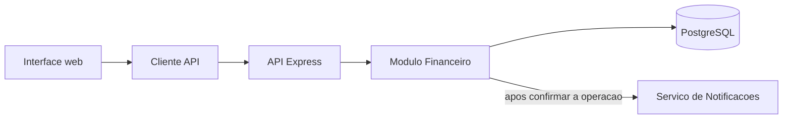

# Smart Campus — Gestão Financeira de Estudantes

Módulo financeiro do Smart Campus da Universidade Joaquim Alberto Chissano (UJAC). Mantém as dívidas, os pagamentos, as contestações e o estado de regularidade financeira dos estudantes, disponibilizando estes dados aos restantes módulos da plataforma.

## O que o módulo faz

- Regista e consulta dívidas associadas a estudantes.
- Confirma pagamentos e actualiza o estado das dívidas.
- Calcula e expõe a situação financeira do estudante (`ACTIVE` ou `BLOCKED`).
- Permite que estudantes submetam contestações e que a tesouraria as resolva.
- Mantém políticas financeiras, relatórios e auditoria das operações.
- Cria avisos financeiros e, quando configurado, entrega-os ao módulo externo de Notificações.

O `studentId` usado pelo Financeiro é o `User.id` fornecido pelo Core; não é o número de matrícula.

## Como funciona

O projecto é um monorepo npm. A API Express aplica autenticação, autorização e validação antes de chamar os casos de uso do módulo; o domínio concentra as regras financeiras e o Prisma persiste os dados em PostgreSQL.



As rotas financeiras usam a base `/api/v1/financial`. O Core é responsável pela identidade, sessões e perfis. Um estudante só pode consultar os próprios dados; `FINANCE` e `ADMIN` executam operações de tesouraria, enquanto políticas financeiras são alteradas apenas por `ADMIN`.

## Executar localmente

### 1. Preparar o ambiente

São necessários Node.js 20 ou 22, npm e Docker Compose. Na raiz do projecto:

```bash
npm install
cp -n .env.example .env
docker compose up -d db
npm run db:generate
npm run db:migrate:dev
npm run db:seed
```

Antes de executar o seed, defina no `.env` `SMART_CAMPUS_SEED_PASSWORD` com pelo menos 12 caracteres. Defina também uma `JWT_SECRET` local forte e confirme a `DATABASE_URL`. Nunca adicione o ficheiro `.env`, contas, palavras-passe, tokens ou chaves privadas ao Git.

### 2. Iniciar a aplicação

```bash
npm run build:packages
npm run dev:api
```

Noutro terminal:

```bash
npm run dev:web
```

| Serviço | Endereço |
|---|---|
| Interface web | http://localhost:3000 |
| API | http://localhost:4100/api/v1 |
| Swagger | http://localhost:4100/api/docs |
| Health check | http://localhost:4100/health |

## Integrar com a API

1. Autentique um utilizador autorizado através de `POST /api/v1/auth/login`, usando uma conta criada no seu ambiente local ou no provedor de identidade do Core.
2. Envie o access token recebido no cabeçalho `Authorization: Bearer <access-token>`.
3. Consuma as rotas financeiras conforme o perfil do utilizador.
4. Trate as respostas de sucesso como `{ data, meta }` e os erros como `{ code, message, details?, correlationId }`.

| Objectivo | Endpoint |
|---|---|
| Listar ou consultar dívidas | `GET /financial/debts`, `GET /financial/debts/:id` |
| Criar dívida | `POST /financial/debts` |
| Confirmar pagamento | `POST /financial/payments` |
| Consultar regularidade | `GET /financial/students/:studentId/status` |
| Consultar histórico e avisos | `GET /financial/students/:studentId/history`, `GET /financial/students/:studentId/notifications` |
| Submeter ou resolver contestação | `POST /financial/analysis-requests`, `PATCH /financial/analysis-requests/:id` |
| Consultar relatórios | `GET /financial/reports` |
| Consultar ou alterar políticas | `GET`, `PATCH /financial/policies/:policyId` |

Para integrações entre módulos, use sempre o `User.id` do Core e propague `x-correlation-id` quando estiver a encadear operações. A referência completa de pedidos, permissões e formatos está no [Swagger local](http://localhost:4100/api/docs) e nos [contratos financeiros](docs/contratos-financial.md).

### Integração com Notificações

O Financeiro cria o aviso na mesma operação de negócio e tenta a entrega depois da confirmação da transacção. Configure `NOTIFICATIONS_API_URL` e `NOTIFICATIONS_API_TOKEN` apenas no ambiente seguro onde a integração vai correr; use HTTPS e uma credencial de serviço, nunca o JWT do estudante.

Sem essa configuração, os avisos ficam pendentes e não são enviados. O receptor deve aceitar repetições pelo mesmo `sourceEventId`, para que novas tentativas não criem duplicados. Consulte o [contrato de Notificações](docs/integracao-notificacoes.md) antes de ligar os serviços.

## Verificar e manter

```bash
npm run test:unit
npm run docs:check
```

Para validar a integração com PostgreSQL num ambiente descartável com Docker, execute `npm run test:security:isolated`.

Dicas de manutenção:

- Altere contratos partilhados em `packages/shared-types` e validações em `packages/validation` antes de alterar consumidores.
- Acompanhe cada alteração do schema Prisma com uma migração.
- Não registe em documentação, evidências ou logs valores de autenticação, dados pessoais reais ou URLs privadas.
- Use os contratos e o OpenAPI como fonte de integração; não dependa de dados do seed para aplicações externas.

## Referências

- [Contratos de integração](docs/contratos-financial.md)
- [Especificação funcional](docs/especificacao-modulo-gestao-financeira.md)
- [Modelo de dados](docs/exercicio-1/atributos-e-relacoes.md)
- [OpenAPI](docs/openapi.yaml)
